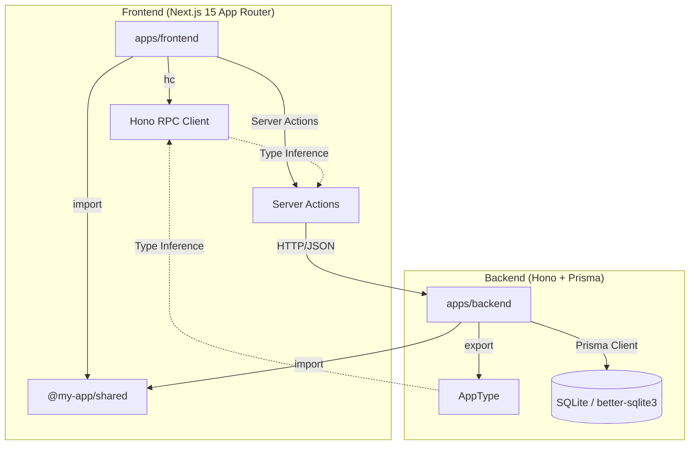
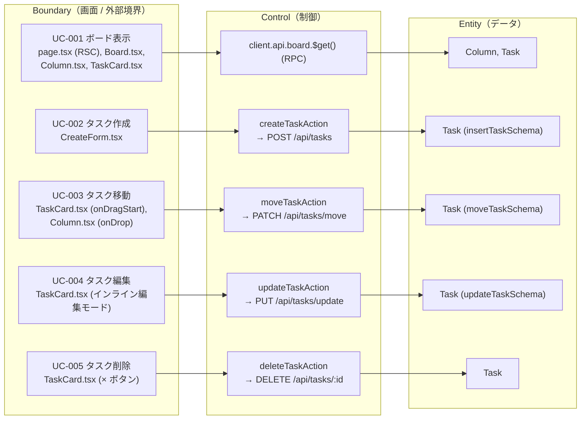
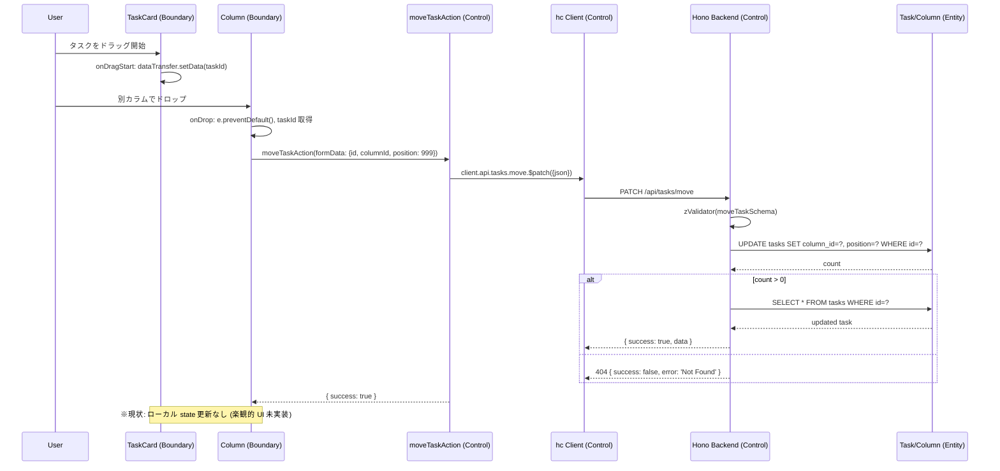
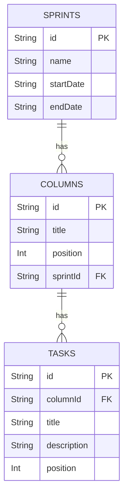
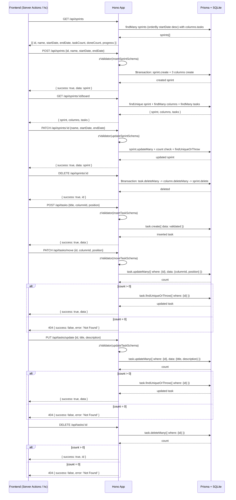
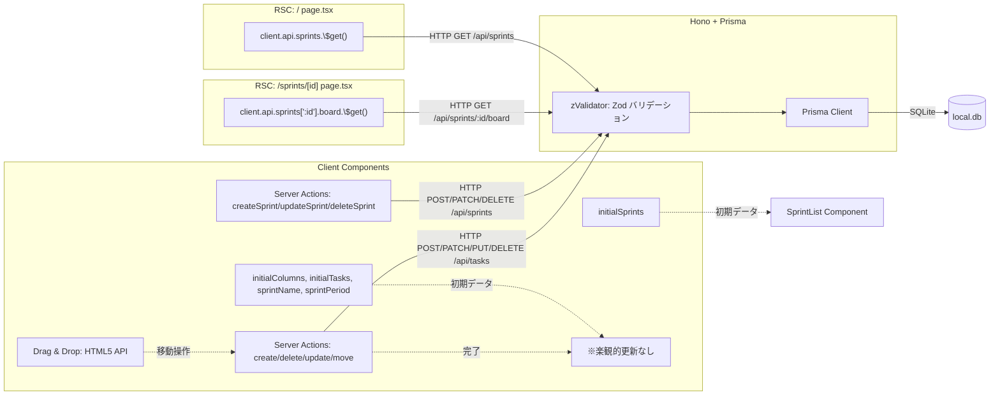

# アーキテクチャ設計書

## 1. システム全体構成

### 1.1 アーキテクチャパターン

本システムは **レイヤードアーキテクチャ**（フロントエンド層 / API 層 / データアクセス層）を採用し、Hono RPC による End-to-End 型安全性を担保する。

| レイヤー | 担当 | 技術 |
|---------|------|------|
| プレゼンテーション層 | RSC + Client Components + Server Actions | Next.js 15, React 19 |
| アプリケーション層 | REST API ルート + バリデーション | Hono, Zod (`zValidator`) |
| データアクセス層 | ORM 経由の永続化 | Prisma ORM, better-sqlite3 |

### 1.2 システム構成図



### 1.3 コンポーネント関係

| コンポーネント | 役割 | 技術 |
|--------------|------|------|
| `apps/frontend` | Next.js 15 App Router (RSC + Server Actions) | React 19, Next.js 15 |
| `apps/backend` | REST API サーバー | Hono, Prisma ORM |
| `packages/shared` | 共有 Zod スキーマ | Zod, TypeScript |
| `SQLite (better-sqlite3)` | 永続化ストレージ | Prisma Adapter |

---

## 2. 堅牢性分析（Boundary–Control–Entity）

堅牢性分析は必要に応じて適用する。本節では、責務分担の整理が必要なタスク移動（UC-003）を中心に、ユースケースを「画面/外部境界（Boundary）」「制御（Control）」「データ（Entity）」へ分解し、コード構造へのマッピングを示す。ユースケース仕様の正本は [`docs/usecases.md`](usecases.md)、エンティティ定義の正本は [`docs/domain_model.md`](domain_model.md) を参照。

### 2.1 BCE マッピング



### 2.2 シーケンス図：タスク移動（UC-003）

堅牢性分析の代表例。タスク移動（Drag & Drop → Server Action → API → DB）の動的フローを示す。



---

## 3. ディレクトリ構造

ディレクトリ構造とファイル配置ルールは [`docs/conventions.md#1-フォルダファイル構成`](conventions.md#1-フォルダファイル構成) を参照してください。

---

## 4. データモデル



### 4.1 CRUD 表

縦軸の種類ごとに表を分ける。

#### 4.1.1 画面 × エンティティ

| 画面 / エンティティ | sprints | columns | tasks | 備考 |
|-----------------|:------:|:-------:|:-----:|------|
| **スプリント一覧画面** (`/`) | R | - | - | 進捗集計含む |
| **ボード表示画面** (`/sprints/[id]`) | R | R | R | 全データ取得 |

#### 4.1.2 API × エンティティ

| API エンドポイント / エンティティ | sprints | columns | tasks | 備考 |
|---------------------------|:------:|:-------:|:-----:|------|
| **GET /api/sprints** | R | - | - | 進捗集計含む |
| **POST /api/sprints** | C | C (3固定) | - | カラム自動生成 |
| **GET /api/sprints/:id/board** | R | R | R | 全データ取得 |
| **PATCH /api/sprints/:id** | U | - | - | 名称・期間変更 |
| **DELETE /api/sprints/:id** | D | D (カスケード) | D (カスケード) | 関連 Column/Task も削除 |
| **POST /api/tasks** | - | - | C | 指定 Column へ追加 |
| **PATCH /api/tasks/move** | - | - | U (columnId, position) | 列間・順序変更 |
| **PUT /api/tasks/update** | - | - | U (title, description) | インライン編集 |
| **DELETE /api/tasks/:id** | - | - | D | 物理削除 |

#### 4.1.3 機能（ユースケース） × エンティティ

| 機能（ユースケース） / エンティティ | sprints | columns | tasks | 備考 |
|--------------------------|:------:|:-------:|:-----:|------|
| **UC-001 スプリント管理** | C/R/U/D | C/D | D | 一覧・作成・更新・削除 |
| **UC-002 タスク作成** | - | - | C | - |
| **UC-003 タスク移動** | - | - | U | columnId, position |
| **UC-004 タスク編集** | - | - | U | title, description |
| **UC-005 タスク削除** | - | - | D | - |

#### 権限・制約サマリ

| 項目 | 内容 |
|------|------|
| **認証・認可** | 未実装（全操作許可） |
| **所有権チェック** | 未実装（他ユーザーの Sprint/Task 操作可能） |
| **バリデーション** | Zod によるスキーマ検証（API 層） |
| **整合性制約** | Prisma リレーション + カスケード削除、FK 制約 |
| **楽観的ロック** | 未実装（version フィールドなし） |
| **ソフトデリート** | 未実装（物理削除のみ） |

**凡例:**
- **C** = Create（作成）
- **R** = Read（読取）
- **U** = Update（更新）
- **D** = Delete（削除）
- **-** = 該当なし・操作対象外

---

### テーブル定義 (Prisma `schema.prisma`)

#### `Sprint` モデル (`sprints` テーブル)
| フィールド | 型 | 制約 | 説明 |
|-----------|-----|------|------|
| `id` | `String` | `@id` (PK) | スプリント一意識別子 (UUID) |
| `name` | `String` | NOT NULL, `@zod.min(1)` | スプリント名 |
| `startDate` | `String` | NOT NULL | 開始日 (ISO 形式 YYYY-MM-DD) |
| `endDate` | `String` | NOT NULL | 終了日 (ISO 形式 YYYY-MM-DD) |
| `columns` | `Column[]` | リレーション | 所有カラム (カスケード削除) |

#### `Column` モデル (`columns` テーブル)
| フィールド | 型 | 制約 | 説明 |
|-----------|-----|------|------|
| `id` | `String` | `@id` (PK) | カラム一意識別子 (例: `col-<sprintId>-todo`) |
| `title` | `String` | NOT NULL, `@zod.min(1)` | 表示名 (例: `Todo 📝`) |
| `position` | `Int` | NOT NULL | 表示順 (0, 1, 2) |
| `sprintId` | `String` | `@map("sprint_id")`, FK | 所属スプリント (`Sprint.id` 参照, `onDelete: Cascade`) |
| `sprint` | `Sprint` | リレーション | 親スプリント |
| `tasks` | `Task[]` | リレーション | 所属タスク (カスケード削除) |

#### `Task` モデル (`tasks` テーブル)
| フィールド | 型 | 制約 | 説明 |
|-----------|-----|------|------|
| `id` | `String` | `@id` (PK) | タスク一意識別子 (UUID) |
| `columnId` | `String` | `@map("column_id")`, FK | 所属カラム (`Column.id` 参照, `onDelete: Cascade`) |
| `title` | `String` | NOT NULL, `@zod.min(1)` | タスクタイトル (1 文字以上) |
| `description` | `String?` | NULLABLE | タスク説明 |
| `position` | `Int` | NOT NULL | カラム内表示順 |
| `column` | `Column` | リレーション | 親カラム |

---

## 5. コンポーネント設計

### 5.1 共有パッケージ (`@my-app/shared`)

**責務**: バックエンドの Prisma スキーマから `prisma-zod-generator` で自動生成される Zod スキーマをフロントエンドへ中継・エクスポート

```typescript
// packages/shared/src/index.ts
export { insertTaskSchema, insertColumnSchema, insertSprintSchema, updateSprintSchema } from '../../../apps/backend/src/db/schema'
export type { CreateTaskInput, CreateSprintInput } from '../../../apps/backend/src/db/schema'
```

**エクスポート:**
- `insertTaskSchema` - タスク作成用 Zod スキーマ (`title` 必須, `description` 任意, `position` coerce)
- `insertColumnSchema` - カラム作成用 Zod スキーマ (`title` 必須)
- `insertSprintSchema` - スプリント作成用 Zod スキーマ (`name` 必須, `startDate`/`endDate` ISO日付 + 期間バリデーション)
- `updateSprintSchema` - スプリント更新用 Zod スキーマ (`id` 除く)
- `CreateTaskInput` - `z.infer<typeof insertTaskSchema>` 型
- `CreateSprintInput` - `z.infer<typeof insertSprintSchema>` 型

---

### 5.2 バックエンド (`apps/backend`)

#### 5.2.1 データベース層 (`src/db/`)

| ファイル | 責務 |
|----------|------|
| `schema.ts` | `prisma-zod-generator` 生成スキーマ (`TaskModelSchema`, `ColumnModelSchema`, `SprintModelSchema`) を import し、フロントエンド用に調整 (`omit`, `extend`, `nullish`, `coerce`) |
| `index.ts` | `@prisma/adapter-better-sqlite3` で better-sqlite3 接続 + `PrismaClient` export |
| `seed.ts` | **廃止**: スプリント作成時に 3 カラムをトランザクションで自動生成するため、起動時シードは不要 |

#### 5.2.2 API ルート (`src/index.ts`)



**エンドポイント一覧** → 詳細は [`docs/api.md`](api.md) を参照

#### 5.2.3 サーバー起動 (`src/server.ts`)

```typescript
import { serve } from '@hono/node-server'
import app from './index'

const port = Number(process.env.PORT ?? 3000)
serve({ fetch: app.fetch, port })
```

#### 5.2.4 型定義・エクスポート

```typescript
// apps/backend/src/index.ts
export type AppType = typeof routes  // Hono RPC 用の型エクスポート
export default app
```

---

### 5.3 フロントエンド (`apps/frontend`)

#### 5.3.1 RPC クライアント (`app/client.ts`)

```typescript
import { hc } from 'hono/client'
import type { AppType } from '../../backend/src/index'

export const client = hc<AppType>('http://localhost:3001/')
```

- `AppType` から全エンドポイントの型を推論
- ベース URL は開発時 `http://localhost:3001/`

#### 5.3.2 Server Actions (`app/actions.ts`)

```typescript
'use server'

import { revalidatePath } from 'next/cache'
import { client } from './client'
import { insertTaskSchema, insertSprintSchema, updateSprintSchema } from '@my-app/shared'
import { parseWithZod } from '@conform-to/zod'

export async function createTaskAction(formData: FormData) { ... }
export async function deleteTaskAction(formData: FormData) { ... }
export async function updateTaskAction(formData: FormData) { ... }
export async function moveTaskAction(formData: FormData) { ... }
export async function createSprintAction(formData: FormData) { ... }
export async function updateSprintAction(formData: FormData) { ... }
export async function deleteSprintAction(formData: FormData) { ... }
```

- `'use server'` ディレクティブでサーバー専用関数化
- Conform `parseWithZod` でフォームデータをバリデーション
- RPC クライアント経由でバックエンド API 呼び出し
- `submission.reply()` で Conform 対応レスポンス返却
- スプリント操作の Server Action 実行後に `revalidatePath` で一覧 / 詳細を更新

#### 5.3.3 ページコンポーネント

**一覧ページ (`app/page.tsx` - RSC):**
```typescript
import { client } from './client'
import SprintList from '@/components/SprintList'

export default async function SprintListPage() {
  const res = await client.api.sprints.$get()
  if (!res.ok) throw new Error('データ取得失敗')
  const sprints = await res.json()

  return <SprintList initialSprints={sprints} />
}
```

**詳細ページ (`app/sprints/[id]/page.tsx` - RSC):**
```typescript
import { notFound } from 'next/navigation'
import { client } from '../../client'
import Board from '@/components/Board'

export default async function SprintBoardPage({
  params,
}: {
  params: Promise<{ id: string }>
}) {
  const { id } = await params
  const res = await client.api.sprints[':id'].board.$get({ param: { id } })
  if (res.status === 404) {
    notFound()
  }
  if (!res.ok) {
    throw new Error('データ取得失敗')
  }
  const { sprint, columns, tasks } = await res.json()

  return (
    <Board
      initialColumns={columns}
      initialTasks={tasks}
      sprintName={sprint.name}
      sprintPeriod={`${sprint.startDate} 〜 ${sprint.endDate}`}
    />
  )
}
```

- **React Server Component (RSC)**: サーバーでデータ取得、HTML ストリーミング
- 一覧: `client.api.sprints.$get()` でスプリント一覧取得
- 詳細: `client.api.sprints[':id'].board.$get()` でボードデータ取得、404 時は `notFound()`
- Client Component (`SprintList`, `Board`) に初期データを props で渡す

#### 5.3.4 ボードコンポーネント (`components/Board.tsx` - Client Component)

```typescript
'use client'

import { useState } from 'react'
import { moveTaskAction } from '../app/actions'
import Column from './Column'

export default function Board({ initialColumns, initialTasks }: BoardProps) {
  const [tasks, setTasks] = useState<Task[]>(initialTasks)

  const handleTaskMove = async (taskId: string, targetColumnId: string) => {
    const formData = new FormData()
    formData.set('id', taskId)
    formData.set('columnId', targetColumnId)
    formData.set('position', '999')
    await moveTaskAction(formData)
    // 注: 現状楽観的 UI 未実装。Server Action 完了後は再取得なし
  }
  // ...
}
```

- `'use client'` でクライアントコンポーネント化
- `useState` でローカル タスク状態管理
- Server Actions (`moveTaskAction` 等) でミューテーション実行

#### 5.3.5 カラム・タスクカード・作成フォーム

| コンポーネント | 責務 | 主なフック/API |
|--------------|------|----------------|
| `SprintList.tsx` | スプリント一覧表示、作成フォーム配置、空状態 | `SprintCreateForm`, `SprintCard` |
| `SprintCreateForm.tsx` | スプリント作成フォーム、Conform + Zod バリデーション | `useActionState` (createSprintAction), `useForm`, `parseWithZod` |
| `SprintCard.tsx` | スプリントカード表示、進捗バー、インライン編集、削除 | `useState` (編集モード), `useActionState` (updateSprintAction, deleteSprintAction) |
| `Column.tsx` | カラム表示、ドロップターゲット、作成フォーム配置 | `onDragOver`, `onDrop`, `CreateForm` |
| `TaskCard.tsx` | タスク表示、ドラッグソース、インライン編集、削除 | `useState` (編集モード), `useActionState` (更新/削除), `onDragStart` |
| `CreateForm.tsx` | タスク作成フォーム、Conform + Zod バリデーション | `useActionState` (createTaskAction), `useForm`, `parseWithZod` |

#### 5.3.6 レイアウト (`app/layout.tsx`)

```typescript
export const metadata: Metadata = {
  title: '🚀 超高速フルスタック・タスクボード',
  description: 'End-to-End 型安全なフルスタック・カンバンアプリ',
}

export default function RootLayout({ children }) {
  return (
    <html lang="ja">
      <head>...</head>
      <body><div id="root">{children}</div></body>
    </html>
  )
}
```

- Next.js `Metadata` API で SEO 対応
- ルートレイアウトとして全ページ共通 UI 提供

---

## 6. データフロー



**注意**: タスク操作系 Server Action（作成・移動・更新・削除）実行後のローカル状態自動更新（楽観的 UI や再取得）は未実装。手動リロードまたは実装追加が必要。
- スプリント操作の Server Action（作成・更新・削除）実行後は `revalidatePath` で一覧 / 詳細を再取得する（Task 5 実装済み）

---

## 7. エラーハンドリング方針

### 7.1 バックエンド
| 種別 | 対応 | HTTP ステータス |
|------|------|----------------|
| バリデーション失敗 | `zValidator` 自動処理、エラー詳細返却 | 400 |
| Prisma エラー | try-catch で捕捉、ログ出力後汎用エラー | 500 |
| リソース不存在 | `updateMany`/`deleteMany` の count で判定 | 404 |

### 7.2 フロントエンド
| 種別 | 対応 |
|------|------|
| RSC データ取得失敗 | `throw new Error` → Next.js Error Boundary (`error.tsx` 未実装) |
| Server Action 失敗 | Conform `submission.reply()` でフォームにエラー表示 (`CreateForm`) |
| `useActionState` 失敗 | 戻り値 `{ success: false, error }` でハンドリング (`TaskCard`) |
| ネットワークエラー | ブラウザ標準エラー、トースト通知未実装 |

---

## 8. クラス図（主要インターフェース）

```mermaid
classDiagram
    class AppType {
        +api: APIRoutes
    }
    
    class APIRoutes {
        +sprints: SprintAPI
        +tasks: TaskAPI
    }
    
    class SprintAPI {
        +$get(): SprintListResponse[]
        +$post(json: CreateSprintInput): SprintResponse
        +':id': SprintIdAPI
    }
    
    class SprintIdAPI {
        +$patch(json: UpdateSprintInput): SprintResponse
        +$delete(param: string): DeleteResponse
        +board: SprintBoardAPI
    }
    
    class SprintBoardAPI {
        +$get(param: string): SprintBoardResponse
    }
    
    class TaskAPI {
        +$post(json: CreateTaskInput): TaskResponse
        +$delete(param: string): DeleteResponse
        +update: UpdateAPI
        +move: MoveAPI
    }
    
    class UpdateAPI {
        +$put(json: UpdateTaskInput): TaskResponse
    }
    
    class MoveAPI {
        +$patch(json: MoveTaskInput): TaskResponse
    }
    
    class SprintListResponse {
        +id: string
        +name: string
        +startDate: string
        +endDate: string
        +taskCount: number
        +doneCount: number
        +progress: number
    }
    
    class SprintResponse {
        +success: true
        +data: SprintListResponse
    }
    
    class SprintBoardResponse {
        +success: true
        +data: SprintBoardData
    }

    class SprintBoardData {
        +sprint: SprintListResponse
        +columns: Column[]
        +tasks: Task[]
    }
    
    class Column {
        +id: string
        +title: string
        +position: number
    }
    
    class Task {
        +id: string
        +columnId: string
        +title: string
        +description: string | null
        +position: number
    }
    
    class CreateSprintInput {
        +id: string
        +name: string
        +startDate: string
        +endDate: string
    }
    
    class UpdateSprintInput {
        +name?: string
        +startDate?: string
        +endDate?: string
    }
    
    class CreateTaskInput {
        +id: string
        +columnId: string
        +title: string
        +description?: string
        +position: number
    }
    
    class MoveTaskInput {
        +id: string
        +columnId: string
        +position: number
    }
    
    class UpdateTaskInput {
        +id: string
        +title: string
        +description: string | null
    }
    
    class TaskResponse {
        +success: true
        +data: Task
    }
    
    class DeleteResponse {
        +success: true
        +id: string
    }
    
    AppType --> APIRoutes
    APIRoutes --> SprintAPI
    APIRoutes --> TaskAPI
    SprintAPI --> SprintIdAPI
    SprintIdAPI --> SprintBoardAPI
    TaskAPI --> UpdateAPI
    TaskAPI --> MoveAPI
```


