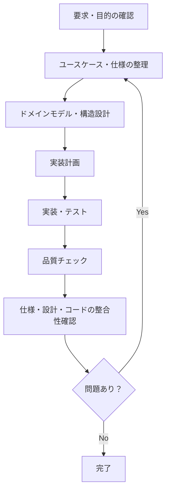
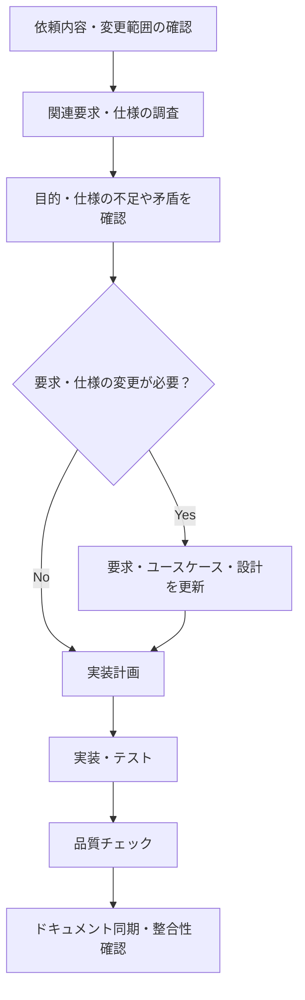

# ドキュメント作成ガイドライン

本ドキュメントは、本プロジェクトの設計ドキュメントの構成、記載内容、更新方針、開発プロセスを定義します。

本プロジェクトでは、ユースケース駆動設計（Use Case Driven Development: UCDD）を基本とし、要求から設計・実装・テストまでのトレーサビリティを確保します。

ただし、すべての変更に同一の開発プロセスや成果物を強制するのではなく、変更の目的、複雑さ、影響範囲に応じて必要な工程とドキュメントを選択します。

## 1. 基本方針

### 1.1 要求の背景・目的を明確にする

要求を実装する前に、次の事項を把握します。

- 背景：なぜ変更が必要なのか。
- 目的：何を実現・改善したいのか。
- 期待する成果：変更によって何ができるようになるのか。
- 制約：実現方法や設計に影響する制約は何か。
- 優先順位：何を優先して実現するのか。

これらは必ず把握できるようにします。ただし、すべての情報を毎回独立したドキュメントに記載する必要はありません。既存の要求仕様、業務要件、課題管理などに記載されている場合は、それらを参照します。

目的や制約が不明確で、設計・実装上の重要な判断に影響する場合は、推測で確定せず、未確定事項を明示して確認します。

### 1.2 ユーザーストーリーの作成基準

ユーザーストーリーは必須成果物としません。ユーザーの目的や価値を明確にすることが、要求の整理・優先順位付け・関係者間の合意に役立つ場合に作成します。

次のいずれかに該当し、ユーザーの目的や価値を明確にする必要がある場合は、作成を検討します。

- ユーザーの課題、目的、期待する成果が明確でない。
- 複数の実現方法があり、ユーザーにとっての価値を基準に選択する必要がある。
- 要求の優先順位を、ユーザー価値や業務上の効果に基づいて判断する必要がある。
- 関係者間で要求の範囲や期待する成果について認識を合わせる必要がある。
- ユーザーの目的を明確にすることで、不要な機能の追加や過剰な実装を防げる。

一方、次の場合は、原則としてユーザーストーリーを作成しません。

- 既存の要求仕様や業務要件から、目的と期待する成果を十分に把握できる。
- バグ修正など、再現条件・期待結果・実際の結果を記載する方が適切である。
- 内部リファクタリング、依存ライブラリ更新、CI/CD変更など、ユーザーストーリーでは変更目的を表現しにくい。
- 既存の記述と重複するだけで、新たな理解や判断に役立たない。

ユーザーストーリーを作成する場合は、次の形式を基本とします。

> [ユーザーの役割] として、[実現したいこと] をしたい。なぜなら [目的・価値] だから。

ユーザーストーリーは要求の意図を表現するものであり、詳細なシステムの振る舞いや例外処理を定義するものではありません。それらはユースケースや関連する設計ドキュメントに記載します。

AIはユーザーストーリーの作成自体を目的化せず、形式的なストーリーの増殖や既存仕様との重複を避けます。

### 1.3 ユースケース駆動設計

機能の振る舞いを定義する場合は、ユースケースを基本的な設計単位とします。

ユースケースでは、アクターとシステムの相互作用を通じて、目的を達成するまでの振る舞いを記述します。

基本フローだけでなく、業務上重要な代替フロー、例外フロー、事前条件、事後条件を必要な範囲で明確にします。

ユーザーストーリーが存在する場合は、関連する要求やユースケースとの対応関係を明確にします。ただし、すべてのユースケースが個別のユーザーストーリーに対応する必要はありません。

### 1.4 適用範囲を柔軟に判断する

機能追加や業務フロー変更では、要求・ユースケース・関連設計を中心に検討します。

一方、内部リファクタリング、依存ライブラリ更新、CI/CD変更、共通基盤の改善などでは、変更の目的・制約・完了条件を明確にし、適切な単位で計画・実装・検証します。

すべての変更にユーザーストーリー、ユースケース図、シーケンス図、堅牢性分析などを強制してはいけません。

## 2. ドキュメント構成

### 2.1 ドキュメントの役割

各ドキュメントは、担当する情報の単一情報源（Single Source of Truth: SSOT）として管理します。

| ドキュメント | 役割 |
|---|---|
| `README.md` | プロジェクト概要とドキュメントへの入口 |
| `AGENTS.md` | AIへの作業規約 |
| `docs/documentation-guideline.md` | ドキュメント作成・更新規約 |
| `docs/product.md` | 要求、背景、目的、期待する成果 |
| `docs/usecases.md` | ユースケースとシステムの振る舞い |
| `docs/domain_model.md` | ドメイン概念、業務ルール、不変条件 |
| `docs/architecture.md` | アーキテクチャ、コンポーネント責務、データモデル |
| `docs/design.md` | 画面構成、UI、操作・表示仕様 |
| `docs/api.md` | REST API契約 |
| `docs/tech.md` | 技術選定と技術的制約 |
| `docs/conventions.md` | 開発規約、命名規則、ファイル配置、開発手順 |
| `docs/security.md` | セキュリティ要件と対策 |
| `docs/operations.md` | 運用、監視、障害対応 |
| `docs/review.md` | レビュー方針と品質確認基準 |
| `docs/glossary.md` | ドメイン用語の定義と日英対応 |

該当する設計や運用が存在しない場合、すべてのファイルを無条件に作成する必要はありません。

既存のドキュメントが上記の一覧に含まれていない場合は、役割を確認したうえで一覧に追加するか、適切な正本に統合します。既存ファイルを一覧にないという理由だけで削除してはいけません。

### 2.2 ディレクトリ構成

設計ドキュメントは `docs/` 直下に配置します。

```text
docs/
├── product.md
├── usecases.md
├── domain_model.md
├── architecture.md
├── design.md
├── api.md
├── tech.md
├── conventions.md
├── security.md
├── operations.md
├── review.md
├── glossary.md
├── documentation-guideline.md
└── images/
    └── logo.svg
```

上記は標準構成であり、プロジェクトの実際の要件に応じて調整します。

各ドキュメントへの目次・エントリポイントは、プロジェクトルートの `README.md` が担います。`docs/` 直下に `README.md` を作成してはいけません。

## 3. 各ドキュメントの記載内容

### 3.1 `product.md`（プロダクト要求）

プロダクトの背景・目的と、実現すべき要求を定義します。

- プロダクトビジョン
- ターゲットユーザーとアクター
- ユーザーの課題・ニーズ
- 背景、目的、期待する成果
- ビジネス目標と成功指標
- システム境界
- 要求一覧（要求ID、内容、背景・目的、優先順位）
- 機能要求・非機能要求
- ビジネス上の制約事項
- 関連ユースケースID

ユーザーストーリーを作成する場合は、要求との対応が分かるように記載します。作成しない場合も、要求の背景・目的・期待する成果を把握できるようにします。

非機能要求、複数のユースケースにまたがる要求、ユースケースに直接対応しない技術的要求も記載できます。

### 3.2 `usecases.md`（ユースケース仕様）

システムの振る舞いを定義します。

- ユースケース図、ユースケース一覧
- ユースケースID、名称、目的
- 関連要求ID
- 主アクター、副アクター
- 事前条件（Preconditions）
- 事後条件（Postconditions）
- 基本フロー（Main Success Scenario）
- 代替フロー（Alternative Flows）
- 例外フロー（Exception Flows）
- 必要に応じた受け入れ条件や業務ルールへの参照

ユースケースの振る舞いに関する正本とします。

分岐や例外は、実装と検証に必要な範囲を明確に記述します。入力エラー、権限エラー、外部システム障害など、業務上重要なケースを考慮しますが、想定可能な事象を無条件にすべて列挙する必要はありません。

### 3.3 `domain_model.md`（ドメインモデル）

業務上の概念とルールを定義します。

- ドメイン概念と概念間の関係
- エンティティ、値オブジェクト、集約などのモデル（必要に応じて）
- ライフサイクルと状態遷移
- 業務ルール、不変条件、整合性制約
- ユビキタス言語との対応

画面やAPIの都合による表現と、業務上の概念を区別します。

### 3.4 `architecture.md`（アーキテクチャ設計）

システムの構造と責務を定義します。

- アーキテクチャパターン、レイヤー構成
- コンポーネントの責務と依存関係
- システム構成図、配置図
- データモデル、ER図、インデックス方針
- CRUD表
  - データモデル章内に配置
  - **標準構成**は「操作（トリガー）× エンティティ」表と「API × エンティティ」表の2つ
  - **縦軸（行）**：操作表はユーザー操作（表示・作成・編集・削除など）をトリガー単位で並べる。画面単位ではなく操作単位で記述する
  - **横軸（列）**：データベースのテーブルやエンティティ
  - **交差するセル**：その操作がそのデータに対してどの操作を行うか（C・R・U・D）を記述
  - **バッチ軸**：イベント起動バッチなどがある場合、操作表と混在させず「バッチ × エンティティ」の独立した表を新設する。バッチが存在しない場合は表を設けない
  - **機能（ユースケース）軸**：通常は設けない。API 表と重複するため、ユースケース単位のエンティティ対応は堅牢性分析（Boundary–Control–Entity）の図で担保する
  - 「権限・制約サマリ」テーブル：認証・認可、所有権チェック、バリデーション、整合性制約、楽観的ロック、ソフトデリートなど
- エラーハンドリングと共通例外方針
- 必要に応じた堅牢性分析（Robustness Analysis）

堅牢性分析では、必要に応じてBoundary・Control・Entityの責務を整理し、ユースケースの振る舞いと構造設計の関係を明確にします。責務マッピングは、Boundary・Control・Entity をレイヤーごとに整理した図（Mermaid）で表現することを基本とします。

複雑な業務フロー、責務分担が不明確な機能、技術的リスクの高い箇所を中心に適用します。すべてのユースケースについて、詳細なクラス・ファイルのマッピングやシーケンス図を必須としません。

### 3.5 `design.md`（GUIデザイン）

GUIを持つ場合に作成します。

- デザインコンセプト、トーン&マナー
- カラーパレット、タイポグラフィ、アイコン規約
- UIコンポーネント仕様
- レイアウト、グリッド、レスポンシブ対応方針
- 画面デザイン、ワイヤーフレーム、画面遷移
- アクセシビリティ方針

画面の表示・操作仕様の正本とします。

### 3.6 `api.md`（API設計）

バックエンドAPIを提供する場合に作成します。

- エンドポイント、HTTPメソッド、パス
- パラメーター、リクエスト・レスポンスのスキーマ
- ステータスコード、エラーコード、エラー形式
- 認証・認可、レートリミット
- API Gatewayなどの連携仕様
- 関連する要求ID・ユースケースID

REST API契約の唯一の正本とします。他のドキュメントではAPIの責務や依存関係を説明し、詳細仕様は本ファイルを参照します。

### 3.7 `tech.md`（技術選定・技術的制約）

- 言語、フレームワーク、外部サービス
- 開発ツールの選定理由
- 動作環境、バージョン要件、インフラ制約
- 技術的制約と非機能要件
- パフォーマンス、可用性、拡張性などの技術的要件
- 技術選定に関する意思決定記録（ADR）

### 3.8 `conventions.md`（開発規約・手順）

- フォルダ・ファイル構成、配置ルール
- コーディング規約、命名規則（ファイル・変数・型・フレームワーク固有の命名、禁止識別子）
- 新規コンポーネント・関数・スキーマの追加パターン
- テスト規約、Git規約
- セットアップ手順、設定方法、開発コマンド
- リンター、フォーマッター、型チェッカーなどの実行方法
- CI/CDワークフロー

命名規則は本ファイルを正本とし、用語そのものの定義や用語とコード上の識別子の対応は `glossary.md` を参照します。

### 3.9 `security.md`（セキュリティ設計）

セキュリティ上の考慮が必要な場合に作成します。

- 保護対象、機密度、想定される脅威
- 認証・認可の設計
- 暗号化の対象・方式・鍵管理
- CSRF、XSS、SQLインジェクションなどへの対策
- ログと監査の方針
- 既知のリスクと残存課題

### 3.10 `operations.md`（運用手順）

稼働後の運用がある場合に作成します。

- 動作モードと環境設定による挙動の切り替え
- 日常運用の手順
- ログの出力先と確認方法
- 障害時の切り分け手順
- 鍵・認証情報の管理方針
- 本番デプロイ前チェックリスト

### 3.11 `review.md`（レビュー方針）

必要に応じて作成します。

- 要求・ユースケースとの整合性
- 正確性、保守性、性能、セキュリティなどのレビュー観点
- PRレビュープロセス
- 承認ルール、マージ条件
- レビューコメントのガイドライン
- セルフレビューのチェックリスト

### 3.12 `glossary.md`（用語定義）

- ドメイン用語の定義
- 日本語・英語の対応表
- 用語とコード上の識別子との対応
- 技術用語・略語一覧
- 必要に応じた具体例

用語の定義は本ファイルを正本とし、各設計ドキュメントでは用語を統一して使用します。識別子の命名規則や禁止表現は `conventions.md` が正本です。

## 4. 実装計画とタスク分割

実装計画は、変更の目的・影響範囲・依存関係を踏まえて作成します。

### 4.1 タスク分割方針

- 機能開発では、ユースケースまたはシナリオを基本的なタスク分割単位とする。
- 内部ロジックのリファクタリング、ライブラリ更新、CI/CD変更、共通基盤の改善などは、変更の性質に適した単位で分割する。
- 各タスクには、関連する要求ID、ユースケースID、設計ドキュメントを可能な範囲で紐付ける。
- 完了条件には、変更内容に応じたテスト、品質チェック、設計との整合性確認を含める。
- ユースケースに直接対応しないタスクでは、技術要件や品質要件を完了条件の根拠としてよい。

ユーザーストーリーが存在する場合は、関連する要求・ユースケース・タスクの対応関係を必要に応じて追跡できるようにします。ユーザーストーリーが存在しない場合も、要求IDや既存仕様への参照によって追跡可能性を確保します。

### 4.2 進捗管理

進捗管理には、作業を再開できる情報を記録します。

- 完了したタスクと未完了のタスク
- 現在の作業対象と次のアクション
- 実施済みの検証と結果
- 未解決の問題、制約、確認事項
- 重要な判断とその理由

保存先と記録形式は、使用するプラグインや開発ツールの規約に従います。

## 5. README（`README.md`）

READMEは、リポジトリの概要と設計ドキュメントへの入口として機能します。詳細な説明は各設計ドキュメントに委譲します。

### 5.1 含める内容

- SVGロゴ（任意、`docs/images/logo.svg`）
- キャッチコピー
- CI/CDステータスや技術スタックのバージョンなどのバッジ（任意）
- 外部サービス・成果物への重要リンク（該当する場合）
- アプリケーション概要・主要機能
- 設計ドキュメントと用語定義へのリンク

### 5.2 READMEに記載しない内容

- プロジェクト構造のツリー図
- 技術スタックの詳細表
- アーキテクチャの詳細図・詳細説明
- セットアップや開発環境構築の詳細手順
- テスト・品質チェックコマンドの一覧
- 詳細な開発ワークフローや設定手順

これらは、それぞれの責務を持つドキュメントに記載します。

## 6. 開発プロセス

### 6.1 初回セットアップ



1. **要求・目的の確認** — `product.md` と依頼内容から、背景・目的・期待する成果・制約を把握する。
2. **ユーザーストーリーの要否判断** — 1.2の基準に基づいて作成要否を判断する。作成しない場合も、要求の目的は明確にする。
3. **ユースケース・仕様の整理** — 機能に応じて `usecases.md` を作成・更新する。
4. **ドメインモデル・構造設計** — 必要に応じて `domain_model.md` と `architecture.md` を作成・更新する。堅牢性分析は必要な箇所に適用する。
5. **実装計画** — 変更の性質に適した単位でタスクを分割する。
6. **実装・テスト** — 関連仕様に基づいて実装し、対応するテストを作成・実行する。
7. **品質チェック** — リンター、フォーマッター、テスト、型チェックなどを実行する。
8. **整合性確認** — 仕様、設計、実装、テスト、関連ドキュメントの整合性を確認する。

既存プロジェクトの内部変更など、要求・設計の再定義が不要な場合は、影響分析に基づいて必要な工程のみを実施します。

### 6.2 機能追加・修正



1. **影響分析** — 変更がどの要求、ユースケース、ドメインルール、API、画面、技術要件に影響するかを特定する。
2. **仕様・設計更新** — 必要な場合に限り、影響を受ける正本を更新する。
3. **実装計画** — 変更の性質に適した単位でタスクを分割する。
4. **実装・テスト** — 関連仕様に基づいて実装し、必要なテストを作成・実行する。
5. **品質チェック** — プロジェクトで定められた品質チェックを実行する。
6. **ドキュメント同期** — コード変更と同じ作業内で関連ドキュメントを更新する。

要求や外部仕様に影響しない内部変更では、ユーザーストーリーやユースケースを形式的に更新する必要はありません。

## 7. ドキュメント更新ポリシー

### 7.1 単一情報源（SSOT）の原則

同じ仕様の詳細を複数のドキュメントに重複して記述しないでください。情報の種類ごとに正本を定め、他のドキュメントでは必要に応じて参照リンクを使用します。

| 情報の種類 | 正本 |
|---|---|
| プロダクトの目的・要求・優先順位 | `product.md` |
| ユーザーストーリー（作成する場合） | `product.md` または既存の要求管理上の正本 |
| ユースケースのフロー・事前事後条件 | `usecases.md` |
| ドメイン概念・業務ルール・不変条件 | `domain_model.md` |
| アーキテクチャ・コンポーネント責務 | `architecture.md` |
| 画面・UI仕様 | `design.md` |
| REST API契約 | `api.md` |
| 技術選定・技術的制約 | `tech.md` |
| ディレクトリ構造・開発手順 | `conventions.md` |
| セキュリティ設計 | `security.md` |
| 運用手順 | `operations.md` |
| レビュー方針 | `review.md` |
| 用語定義・日英対応 | `glossary.md` |
| 命名規則・識別子 | `conventions.md` |

要求とユースケースは必ずしも1対1に対応しません。1つの要求が複数のユースケースに関係する場合や、複数の要求が1つのユースケースに関係する場合があります。非機能要求や技術的要求がユースケースに直接対応しないことも許容します。

AIは実装・テスト生成時に、ユースケースだけでなく、関連する要求・ドメインルール・API契約・画面仕様・技術的制約を参照します。

テストコードは仕様を検証する成果物であり、仕様そのものの代替とはしません。

### 7.2 更新対象の判断

| コード変更の種類 | 更新対象 |
|---|---|
| プロダクトの目的・要求・アクターの変更 | `product.md` |
| ユーザーストーリーの追加・変更（該当する場合） | `product.md` または既存の要求管理上の正本 |
| ユースケースのフロー・エラー分岐の変更 | `usecases.md` |
| ドメインルール・状態遷移の変更 | `domain_model.md` |
| アーキテクチャ・コンポーネント責務・データモデルの変更 | `architecture.md` |
| GUI・スタイル・UIコンポーネントの変更 | `design.md` |
| APIエンドポイント・リクエスト・レスポンスの変更 | `api.md` |
| 技術スタック・依存ライブラリ・バージョン・インフラの変更 | `tech.md` |
| ディレクトリ構成・命名規則・開発コマンド・CI/CDの変更 | `conventions.md` |
| 認証・認可・暗号化・攻撃対策の変更 | `security.md` |
| 運用モード・ログ出力先・運用手順の変更 | `operations.md` |
| レビュー観点・PRプロセス・承認ルールの変更 | `review.md` |
| 新しいドメイン用語の導入 | `glossary.md` |
| プロジェクト概要・主要機能・外部リンクの変更 | `README.md` |

複数の項目に該当する場合は、必要なドキュメントをすべて更新します。内部実装だけの変更では、仕様に影響しないドキュメントを形式的に更新する必要はありません。

### 7.3 更新原則

- **同一作業内で同期**：コードと関連ドキュメントを同じ作業内で更新する。
- **図表の同期**：振る舞いや構造を表す図を変更した場合は、対応する図も更新する。
- **命名の反映**：新しいドメイン用語を導入した場合は `glossary.md`、命名規則を変更した場合は `conventions.md` を更新する。
- **削除の反映**：削除された機能・API・コンポーネントの記述を関連ドキュメントから削除する。
- **API仕様の集約**：API契約の詳細は `api.md` のみに記載する。
- **推測の排除**：未確認の仕様や検証結果を確定事項として記載しない。
- **変更範囲の限定**：依頼された範囲を超えて無関係なドキュメントを変更しない。

Gitでコミットする運用の場合は、コードと対応するドキュメントを同じコミットに含めます。

## 8. ドキュメント記載ルール

### 8.1 目次・セクション構造

セクション数が10を超える場合は、ドキュメント先頭に目次を追加します。

設計ドキュメントは役割ごとに分割し、1つのファイルに異なる責務の情報を詰め込みすぎないようにします。

### 8.2 図表・ダイアグラム

設計図は関連する設計ドキュメント内に直接記載します。独立した `diagrams/` フォルダは作成しません。

記述形式は次の優先順とします。

1. Mermaid — ユースケース、シーケンス、状態遷移、構成図などに使用する。
2. ASCIIアート — Mermaidが不要な単純な図表に使用する。

構造、関係、フロー、責務分担を表現する場合は、表や文章だけで完結させず、図（Mermaid）による表現を積極的に検討します。たとえばコンポーネント間の関係、画面・制御・データの対応（堅牢性分析）、時系列の相互作用は、図のほうが全体像を伝わりやすくします。

ただし 1.4 に従い、すべてのドキュメント・変更に図を強制しません。表のままが読みやすい内容（CRUD 表など）は表を使います。

図表は必要最小限とし、変更頻度と保守コストを考慮します。コード構造を示す図は、実際の構造と乖離しないようにします。

### 8.3 仕様の明確性

- 要求、設計、制約、未決事項を区別する。
- 条件、結果、エラー時の振る舞いを可能な範囲で具体的に記述する。
- テスト可能な要求は、検証方法や受け入れ条件を明確にする。
- 未確定の仕様は確定事項と区別し、重要な判断をAIの推測だけで確定しない。
- 既存仕様との矛盾を発見した場合は、影響範囲と解決が必要な事項を明示する。
- ユーザーストーリーを作成する場合も、ユースケースや既存要求と重複する詳細を記載しない。

### 8.4 完了チェックリスト

ドキュメントを作成・更新した際は、次の項目を確認します。

- [ ] 適切な正本に情報が記載されている。
- [ ] 要求の背景・目的・期待する成果を把握できる。
- [ ] ユーザーストーリーを作成する場合、目的や価値の明確化に役立っている。
- [ ] 既存の要求・設計との矛盾がない。
- [ ] 必要な要求ID・ユースケースIDとの対応が明確である。
- [ ] 関連する図表と本文が一致している。
- [ ] 用語が `glossary.md`、命名規則が `conventions.md` と整合している。
- [ ] 不要な仕様の重複がない。
- [ ] 参照リンクやファイルパスが正しい。
- [ ] 未確認事項や未実施の検証を、確定事項として記載していない。
- [ ] 変更対象外のドキュメントを不必要に変更していない。
