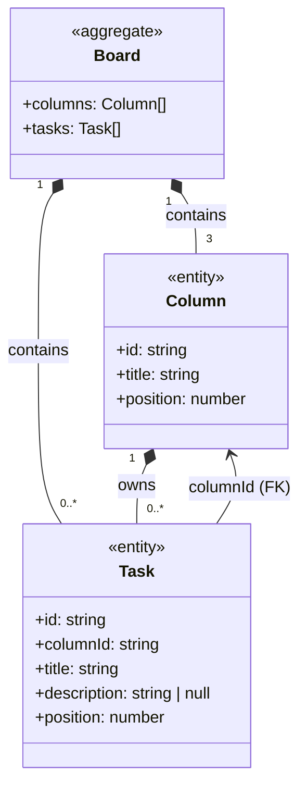
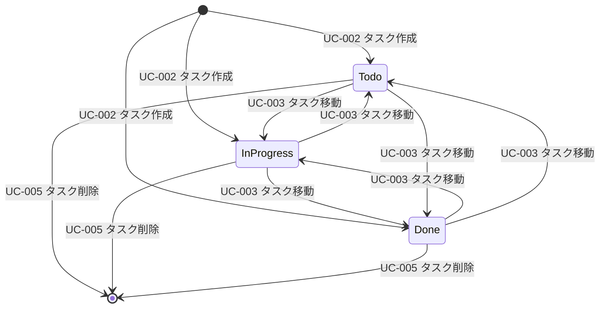

# ドメインモデル

> ユビキタス言語に基づくドメインオブジェクトの定義書です。用語とコード上の命名対応は [`docs/glossary.md`](glossary.md)、ユースケース仕様は [`docs/usecases.md`](usecases.md) を参照してください。
> 物理データモデル（ER図・テーブル定義）は [`docs/architecture.md`](architecture.md) が正本です。

## 1. ドメイン概要

本システムはカンバンボードを管理する。ドメインの中核概念は **カラム（Column）** と **タスク（Task）** の 2 つであり、タスクは必ず 1 つのカラムに所属し、カラム内で順序を持つ。

- **ボード（Board）**: カラムとタスクの集合体。独立エンティティではなく、`Column` 群 + `Task` 群の論理的な集約として扱う
- **カラム（Column）**: タスクを分類する縦の列（Todo / In Progress / Done）。固定 3 つ
- **タスク（Task）**: 作業単位。タイトル・説明・所属カラム・カラム内順序を持つ

## 2. ドメインオブジェクト図

| 分類 | オブジェクト | 説明 |
|------|-------------|------|
| 集約ルート（論理） | `Board` | カラム群とタスク群を包含するボード全体。API レスポンス `BoardResponse` として表現 |
| エンティティ | `Column` | 固定 ID（`col-todo` 等）を持ち、位置とタスク集合を管理する |
| エンティティ | `Task` | UUID ID を持ち、所属カラムと順序・内容を持つ |

## 3. ビジネスルール

| ルール ID | ルール | 関連 UC |
|-----------|--------|---------|
| BR-D01 | タスクは必ず 1 つのカラムに所属する（`columnId` は NOT NULL FK） | UC-002, UC-003 |
| BR-D02 | カラムは固定 3 つ（Todo / In Progress / Done）。追加・削除・改名はスコープ外 | UC-001 |
| BR-D03 | タスクの `title` は 1 文字以上必須。`description` は任意（null 許容） | UC-002, UC-004 |
| BR-D04 | タスクの `position` は 0 以上の整数。カラム内の並び順を表す | UC-002, UC-003 |
| BR-D05 | カラム削除時、配下タスクはカスケード削除される（`onDelete: Cascade`）※カラム自体の削除はスコープ外 | - |
| BR-D06 | タスクの存在しない ID への更新・削除・移動は 404 とする（`updateMany`/`deleteMany` の `count` で判定） | UC-003, UC-004, UC-005 |
| BR-D07 | タスク作成時の `id` はクライアントが `crypto.randomUUID()` で生成する（UUID v4） | UC-002 |

## 4. タスクのライフサイクル・状態遷移

タスクには明示的なステータスフィールドはない。**所属カラム（`columnId`）の組み合わせが事実上の状態**であり、カンバンの各列が進捗状態を表す。

| 遷移 | トリガー | 変更される属性 |
|------|---------|---------------|
| 作成 | UC-002 タスク作成 | `id`（新規 UUID）, `columnId`, `title`, `description`, `position` |
| カラム間移動 | UC-003 タスク移動 | `columnId`, `position` |
| カラム内並び替え | UC-003 タスク移動（同カラム） | `position` ※現状の実装は末尾固定値 `999` |
| 内容更新 | UC-004 タスク編集 | `title`, `description` |
| 削除 | UC-005 タスク削除 | レコード削除（物理削除） |

## 5. エンティティの不変条件

| 対象 | 不変条件 |
|------|---------|
| `Column` | `position` は 0, 1, 2 の固定値。`id` は `col-todo` / `col-progress` / `col-done` |
| `Task` | `columnId` は必ず既存カラム ID を参照する。`title` は空文字不可。`position` は 0 以上 |
| `Board` | 表示時、カラムは `position` 昇順、タスクは所属カラム内 `position` 昇順 |
