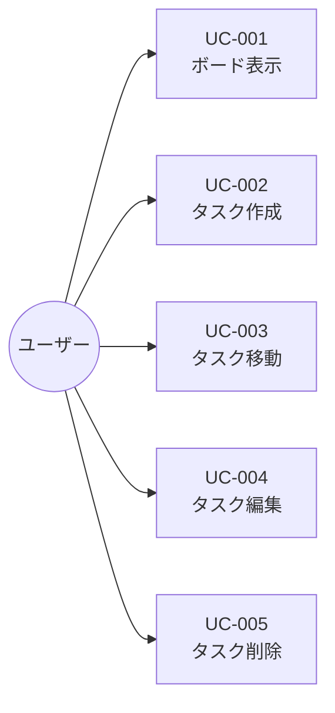

# ユースケース詳細仕様書

> **このファイルはユースケースの振る舞い（アクターとシステムの相互作用）の正本です。**
> ユースケースはすべての仕様の唯一の正本ではありません。実装・テスト生成時は、関連する要求（[`docs/product.md`](product.md)）と各設計ドキュメントも参照します。
> アクター定義は [`docs/product.md`](product.md)、ドメインオブジェクト定義は [`docs/domain_model.md`](domain_model.md) を参照してください。

## 1. ユースケース一覧

| UC ID | 名称 | 主アクター | 関連要求 ID | 概要 |
|-------|------|-----------|------------|------|
| UC-001 | ボード表示 | ユーザー | F-001, F-003, FR-006 | 3 カラムと既存タスクを一覧表示する |
| UC-002 | タスク作成 | ユーザー | F-002, F-007, FR-005 | カラムのフォームからタスクを作成する |
| UC-003 | タスク移動 | ユーザー | F-006, FR-005 | ドラッグ&ドロップでタスクを別カラムへ移動する |
| UC-004 | タスク編集 | ユーザー | F-004, F-007, FR-005 | タスクのタイトル・説明をインライン編集する |
| UC-005 | タスク削除 | ユーザー | F-005, FR-005 | タスクの × ボタンでタスクを削除する |

## 2. ユースケース図

---

## 3. ユースケース詳細

### UC-001: ボード表示

| 項目 | 内容 |
|------|------|
| **UC ID** | UC-001 |
| **名称** | ボード表示 |
| **概要** | アプリ起動時に 3 カラムと既存タスクを一括取得・表示し、現在の進捗を把握できるようにする |
| **関連要求 ID** | F-001, F-003, FR-006 |
| **主アクター** | ユーザー |
| **副アクター** | なし（システム起動時のシード処理は事前条件に含む） |

**事前条件:**
- バックエンドサーバーが起動している
- シード処理により 3 カラム（Todo / In Progress / Done）が DB に存在する（べき等 `upsert`）
- ブラウザでフロントエンド（`http://localhost:3000`）にアクセス可能

**事後条件:**
- 成功時: 3 カラムが `position` 昇順で表示され、各タスクが所属カラム内の `position` 昇順で表示される。カラムヘッダーにタスク数バッジが表示される
- 失敗時: データ取得失敗時はエラーがthrowされる（`error.tsx` 未実装のため Next.js デフォルトエラー表示）

**基本フロー:**
1. ユーザーがブラウザでアプリにアクセスする
2. システムは RSC（`page.tsx`）としてサーバーで初期データを取得する
3. システムは RPC クライアント `client.api.board.$get()` でバックエンドへ `GET /api/board` を送信する
4. システムは全カラム・全タスクを `position` 昇順で返却する
5. システムは `Board` コンポーネントに初期データを props で渡して描画する
6. システムは各カラムにタスク数バッジを表示する

**代替・例外フロー:**
- **4a. サーバーエラー (500)**: DB エラー発生時、システムは汎用エラーレスポンスを返す。RSC 側は `res.ok` をチェックし、失敗時は `throw new Error('データ取得失敗')` とする
- **4b. シード未実行**: カラムが 0 件の場合も 200 を返す（空の `columns` / `tasks`）。シードはバックエンド起動時（`seed.ts`）に実行されるため通常は発生しない

---

### UC-002: タスク作成

| 項目 | 内容 |
|------|------|
| **UC ID** | UC-002 |
| **名称** | タスク作成 |
| **概要** | カラム下部の入力フォームからタイトルを入力し、タスクを作成する |
| **関連要求 ID** | F-002, F-007, FR-005 |
| **主アクター** | ユーザー |
| **副アクター** | なし |

**事前条件:**
- UC-001 によりボードが表示されている
- 対象カラムが存在する

**事後条件:**
- 成功時: 新規タスクが作成され、指定カラムの末尾（`position = 既存タスク数`）に表示される。フォームがリセットされる
- 失敗時（バリデーションエラー）: タスクは作成されず、フィールドエラーがフォームに表示される

**基本フロー:**
1. ユーザーがカラム下部の入力欄にタイトルを入力し「追加」を押す
2. システムは Conform + Zod（`parseWithZod` + `insertTaskSchema`）でクライアント側バリデーションを行う
3. システムは Server Action（`createTaskAction`）を呼び出し、RPC クライアント経由で `POST /api/tasks` を送信する（`id` は `crypto.randomUUID()` でクライアント生成）
4. システムは `zValidator(insertTaskSchema)` でサーバー側バリデーションを行う
5. システムは `task.create` でタスクを永続化する
6. システムは作成されたタスクを返却する
7. システムはフォームをリセットする
8. 新規タスクが該当カラムの末尾に表示される

**代替・例外フロー:**
- **2a. タイトルが空**: クライアント側バリデーションでエラーとなり、`fieldErrors.title` に「タイトルは必須です」を表示して送信しない
- **4a. サーバー側バリデーション失敗 (400)**: `zValidator` がエラー詳細を含む 400 を返す。Server Action は `submission.reply()` でフォームにエラーを表示する
- **5a. DB エラー (500)**: サーバーは汎用エラーレスポンスを返す。作成はされない
- **6a. サーバー同期失敗**: `useActionState` の戻り値 `{ success: false, error }` を受けてエラー表示する

---

### UC-003: タスク移動

| 項目 | 内容 |
|------|------|
| **UC ID** | UC-003 |
| **名称** | タスク移動 |
| **概要** | ドラッグ&ドロップでタスクを別カラムへ移動し、進捗を直感的に更新する |
| **関連要求 ID** | F-006, FR-005 |
| **主アクター** | ユーザー |
| **副アクター** | なし |

**事前条件:**
- UC-001 によりボードが表示されている
- 移動対象のタスクが存在する
- 移動先カラムが存在する

**事後条件:**
- 成功時: タスクの `columnId` が移動先カラムに更新され、`position` が更新される（現状は末尾固定値 `999`）
- 失敗時: タスクは変更されない。エラーが表示される（現状: ローカル state 更新なし、手動リロードで現状復帰）

**基本フロー:**
1. ユーザーがタスクカードをドラッグ開始する
2. システムは `onDragStart` で `dataTransfer` に `taskId` を設定し、ゴーストイメージを表示する（ブラウザ標準）
3. ユーザーが別カラム上でドロップする
4. システムは `onDrop` で `taskId` と移動先 `columnId` を取得する
5. システムは Server Action（`moveTaskAction`）を呼び出し、RPC クライアント経由で `PATCH /api/tasks/move` を送信する（`position` は現状 `999` 固定）
6. システムは `zValidator(moveTaskSchema)` でバリデーションを行う
7. システムは `task.updateMany` で `columnId` と `position` を更新し、`count` で存在を確認する
8. システムは更新後のタスクを返却する
9. ※現状: ローカル state は自動更新されない（楽観的 UI 未実装）。移動完了状態の反映には手動リロードが必要

**代替・例外フロー:**
- **2a. ドラッグキャンセル**: ユーザーがドロップせずにマウスを離した場合、システムはなにもしない
- **6a. バリデーション失敗 (400)**: `moveTaskSchema` 違反時、サーバーは 400 を返す。タスクは変更されない
- **7a. タスクが存在しない (404)**: `updateMany` の `count = 0` 時、サーバーは 404 `{ success: false, error: 'Not Found' }` を返す
- **7b. DB エラー (500)**: サーバーは汎用エラーレスポンスを返す。タスクは変更されない

---

### UC-004: タスク編集

| 項目 | 内容 |
|------|------|
| **UC ID** | UC-004 |
| **名称** | タスク編集 |
| **概要** | タスクカードのタイトルをクリックしてインライン編集し、タイトル・説明を更新する |
| **関連要求 ID** | F-004, F-007, FR-005 |
| **主アクター** | ユーザー |
| **副アクター** | なし |

**事前条件:**
- UC-001 によりボードが表示されている
- 編集対象のタスクが存在する

**事後条件:**
- 成功時: タスクの `title`・`description` が更新される
- 失敗時（バリデーションエラー）: タスクは変更されず、フィールドエラーが表示される
- キャンセル時: 編集モードが解除され、元の表示に戻る

**基本フロー:**
1. ユーザーがタスクタイトルをクリックする
2. システムは編集フォームに切り替える（`useState` で編集モード管理）
3. ユーザーがタイトル・説明を編集し「保存」を押す
4. システムは Server Action（`updateTaskAction`）を呼び出し、RPC クライアント経由で `PUT /api/tasks/update` を送信する
5. システムは `zValidator(updateTaskSchema)` でバリデーションを行う
6. システムは `task.updateMany` で `title`・`description` を更新し、`count` で存在を確認する
7. システムは更新後のタスクを返却する
8. システムは編集モードを解除する

**代替・例外フロー:**
- **1a. 説明を省略して新規作成直後等**: 初期状態では編集モードではないため本フローは開始されない
- **3a. 「閉じる」でキャンセル**: ユーザーが「閉じる」を押した場合、システムはサーバー通信を行わず編集モードを解除して元の表示に戻る
- **5a. タイトルが空**: クライアント／サーバー双方のバリデーションでエラーとなり、「タイトルは必須です」を表示する
- **6a. タスクが存在しない (404)**: `updateMany` の `count = 0` 時、サーバーは 404 を返す
- **6b. DB エラー (500)**: サーバーは汎用エラーレスポンスを返す

---

### UC-005: タスク削除

| 項目 | 内容 |
|------|------|
| **UC ID** | UC-005 |
| **名称** | タスク削除 |
| **概要** | タスクカードの × ボタンでタスクを削除し、完了・不要な作業を除外する |
| **関連要求 ID** | F-005, FR-005 |
| **主アクター** | ユーザー |
| **副アクター** | なし |

**事前条件:**
- UC-001 によりボードが表示されている
- 削除対象のタスクが存在する

**事後条件:**
- 成功時: タスクが DB から削除される
- 失敗時: タスクは削除されない。エラーが表示される
- ※現状: 削除完了の反映には手動リロードが必要（楽観的 UI 未実装）

**基本フロー:**
1. ユーザーがタスクカードの × ボタンを押す
2. システムは Server Action（`deleteTaskAction`）を呼び出し、RPC クライアント経由で `DELETE /api/tasks/:id` を送信する
3. システムは `task.deleteMany` でタスクを削除し、`count` で存在を確認する
4. システムは削除完了を返却する
5. ※現状: ローカル state は自動更新されない。反映には手動リロードが必要

**代替・例外フロー:**
- **3a. タスクが存在しない (404)**: `deleteMany` の `count = 0` 時、サーバーは 404 を返す
- **3b. DB エラー (500)**: サーバーは汎用エラーレスポンスを返す。タスクは削除されない
- **4a. 削除失敗**: `useActionState` の戻り値 `{ success: false, error }` を受けてエラー表示する

---

## 4. ユースケースと API エンドポイントの対応

エンドポイントの詳細仕様は [`docs/api.md`](api.md) が正本です。

| UC ID | エンドポイント | Server Action |
|-------|---------------|---------------|
| UC-001 | `GET /api/board` | なし（RSC が直接 RPC 呼び出し） |
| UC-002 | `POST /api/tasks` | `createTaskAction` |
| UC-003 | `PATCH /api/tasks/move` | `moveTaskAction` |
| UC-004 | `PUT /api/tasks/update` | `updateTaskAction` |
| UC-005 | `DELETE /api/tasks/:id` | `deleteTaskAction` |
